# Proyecto 1 · Mi web en AWS — Librería Tinta
Mario Cerdá Baño · 2º DAW · AWS Learner Lab (us-east-1)

📹 **Vídeo del proyecto:** [Ver en YouTube](https://www.youtube.com/watch?v=Dc90XF0lh_w)

## Arquitectura

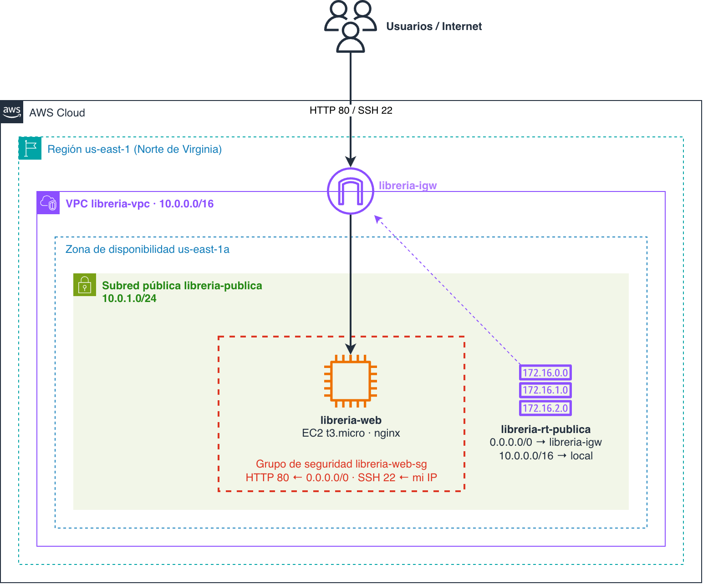

Una VPC con una subred pública en `us-east-1a`. El tráfico de internet entra por el Internet Gateway, la tabla de rutas lo dirige a la subred y el grupo de seguridad solo deja pasar HTTP (a todos) y SSH (solo desde mi IP) hasta el servidor web.

## B1. La red

He creado la red a mano desde la consola de VPC, recurso por recurso:

- **VPC** `libreria-vpc` → `10.0.0.0/16`
- **Subred** `libreria-publica` → `10.0.1.0/24` en `us-east-1a`, con IP pública automática
- **Gateway de internet** `libreria-igw` → asociada a la VPC
- **Tabla de rutas** `libreria-rt-publica` → `0.0.0.0/0` hacia el gateway, asociada a la subred

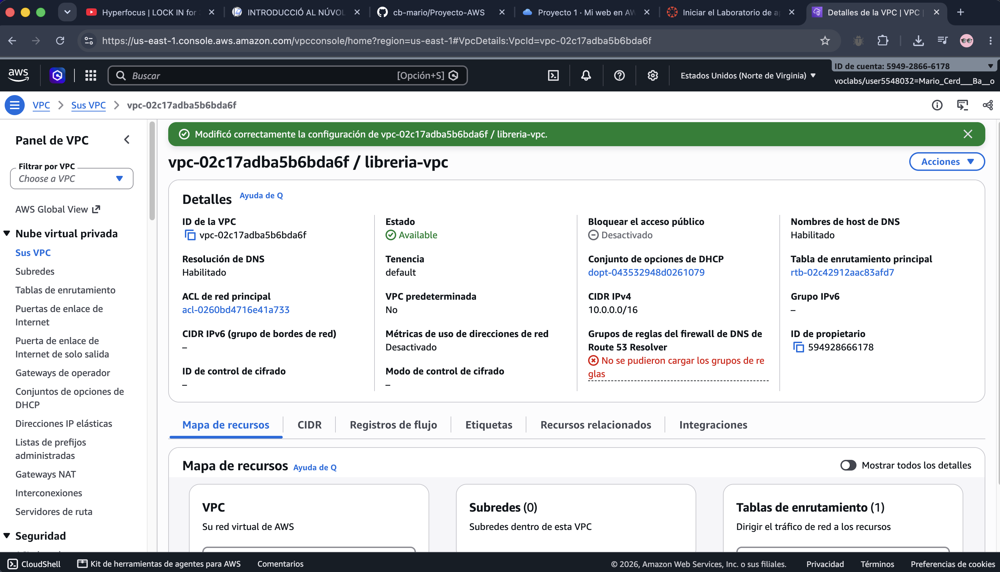
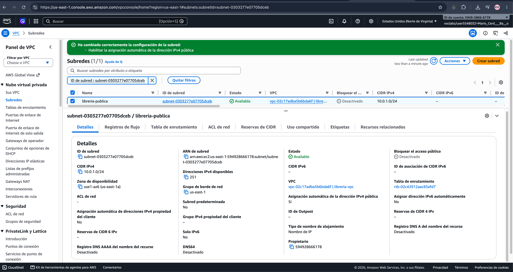
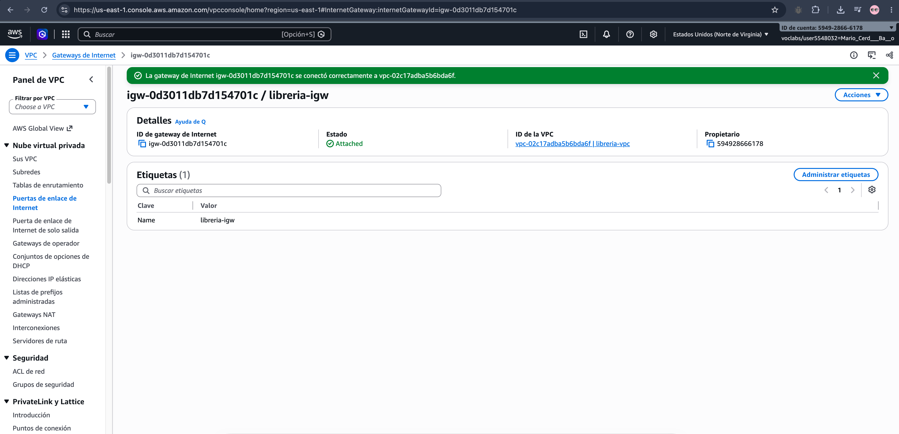
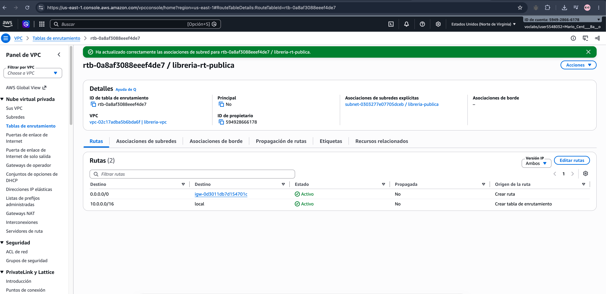
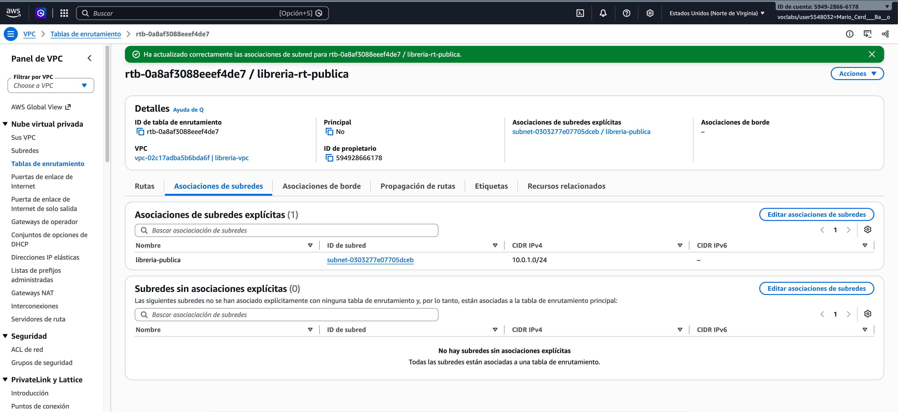

**¿Por qué la subred es pública?** Porque su tabla de rutas manda el tráfico de internet (`0.0.0.0/0`) al gateway, y las instancias reciben IP pública al lanzarse.

## B2. La seguridad

Grupo `libreria-web-sg` con dos reglas de entrada:

- **HTTP (80)** abierto a todos, para que cualquiera vea la web.
- **SSH (22)** solo desde mi IP.

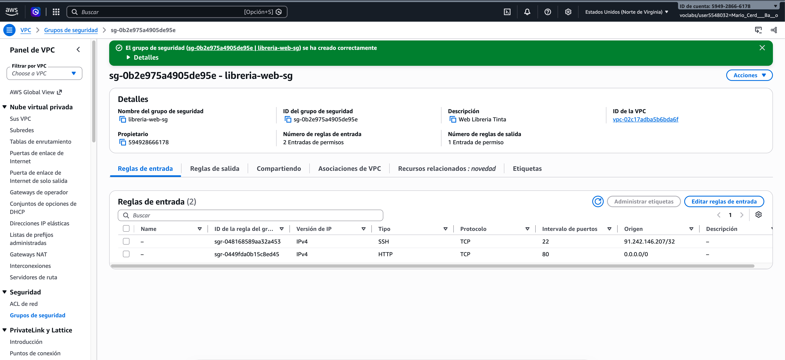

**¿Por qué el SSH solo a mi IP?** Porque es la puerta para administrar el servidor. Si la dejo abierta a todo internet, cualquiera podría intentar entrar.

## B3. El servidor web

Instancia EC2 `libreria-web` con Amazon Linux 2023, tipo `t3.micro`, clave `vockey`, en la subred `libreria-publica` y con el grupo `libreria-web-sg`. Lleva las etiquetas `Proyecto = P1` y `Alumno = Mario Cerdá`.

Al arrancar ejecuta el script [`user-data1.sh`](scripts/user-data1.sh), que instala nginx y publica la página de la librería.

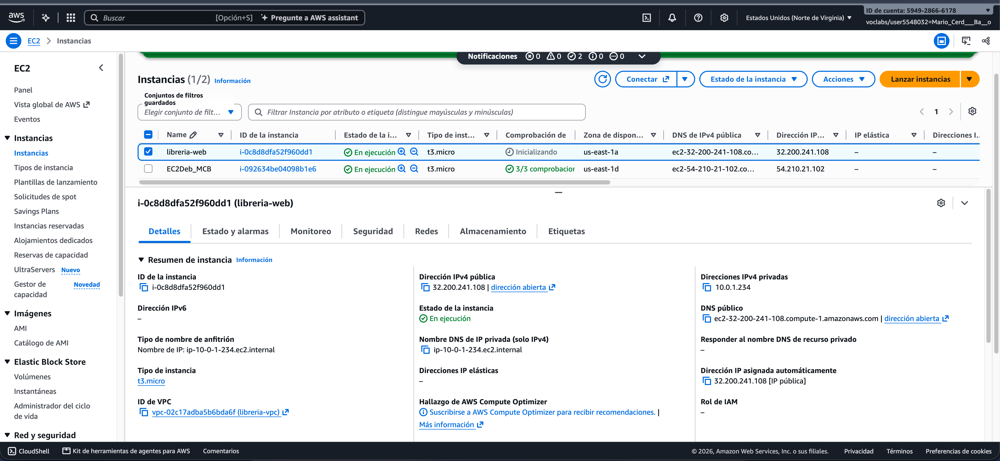
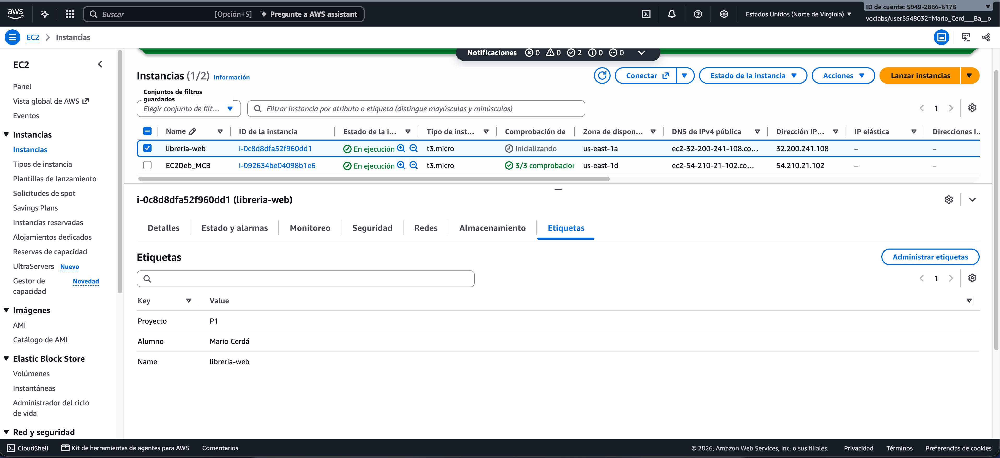
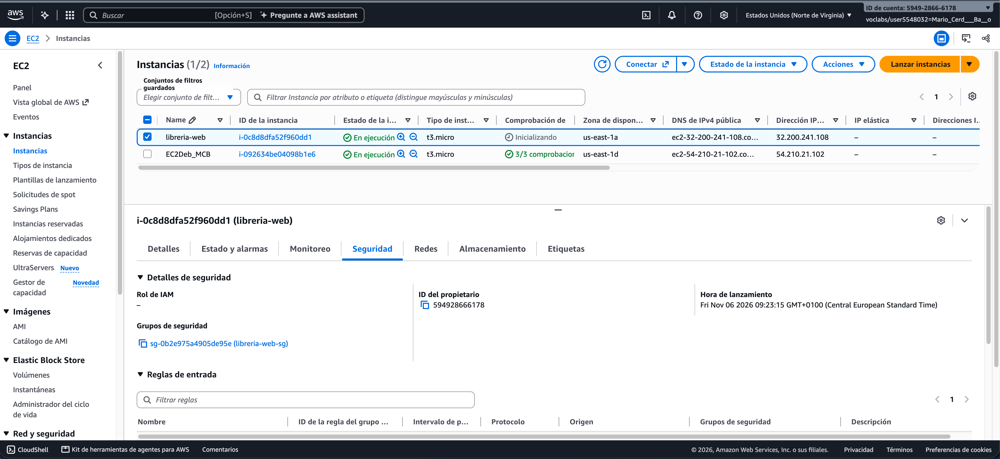

**La web funcionando:**

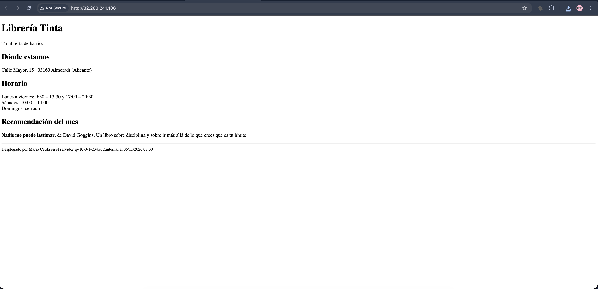

**Conexión por SSH:**

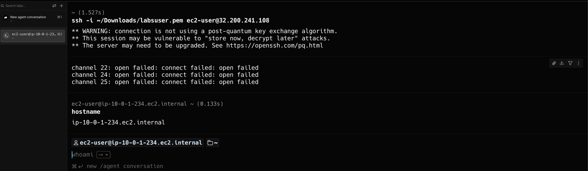

## B4. Cálculo de costes

Estimación con la AWS Pricing Calculator de la instancia `t3.micro` encendida 24/7 en `us-east-1`, bajo demanda y con 8 GB de disco gp3:

- **Coste mensual:** 8,23 USD
- **Coste anual:** 98,76 USD
- **Enlace:** [Ver estimación](https://calculator.aws/#/estimate?id=b66f60d875f58630c9f2126da7431ca4779ca971)

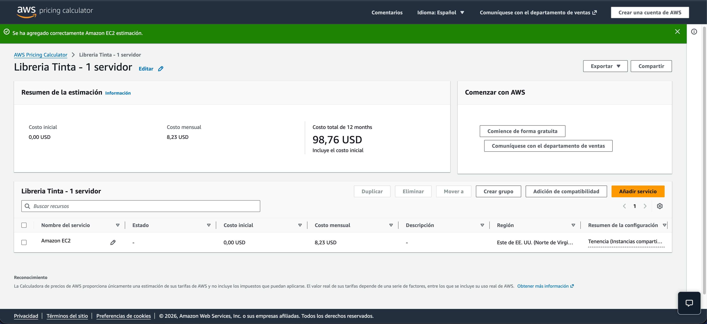

**¿Cómo se podría abaratar?** Apagando el servidor fuera del horario de la tienda, ya que solo se pagarían las horas que está encendido. Otra opción sería un Savings Plan a 3 años, que tiene hasta un 72 % de descuento a cambio de comprometerse a usarlo ese tiempo.

## Nivel medio: DNS ponderado

### M1. Segundo servidor y Route 53

He lanzado una segunda instancia, `libreria-web2`, con la misma VPC, subred y grupo de seguridad. Su script [`user-data2.sh`](scripts/user-data2.sh) crea una página con fondo amarillo y el texto "SERVIDOR 2" para distinguirla.

| Servidor | Instancia | IP privada | Peso |
|---|---|---|---|
| 1 | `libreria-web` | `10.0.1.234` | 80 |
| 2 | `libreria-web2` | `10.0.1.202` | 20 |

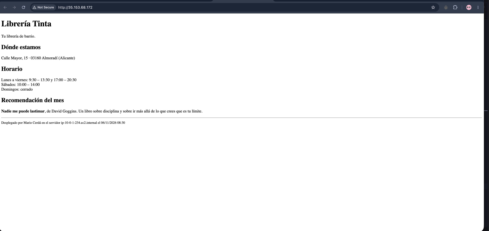
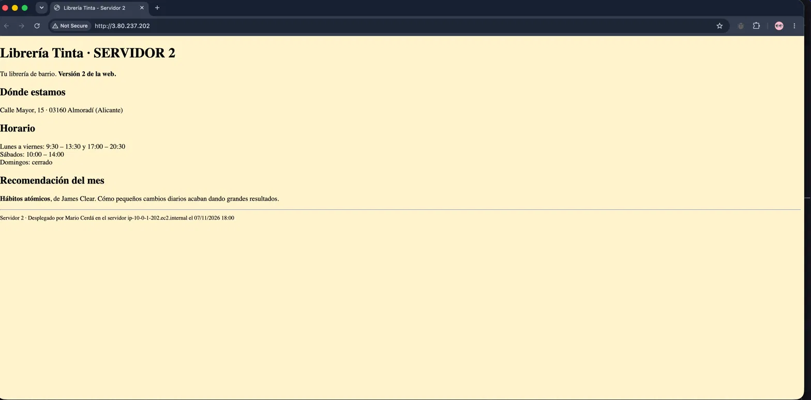

Después he creado una **zona privada** de Route 53, `libreria.lab`, asociada a `libreria-vpc`, con dos registros A para `web.libreria.lab`. Tienen el mismo nombre y el mismo tipo, pero distinto identificador y peso (80 y 20). He puesto un TTL de 10 segundos para que el reparto se note al probar.

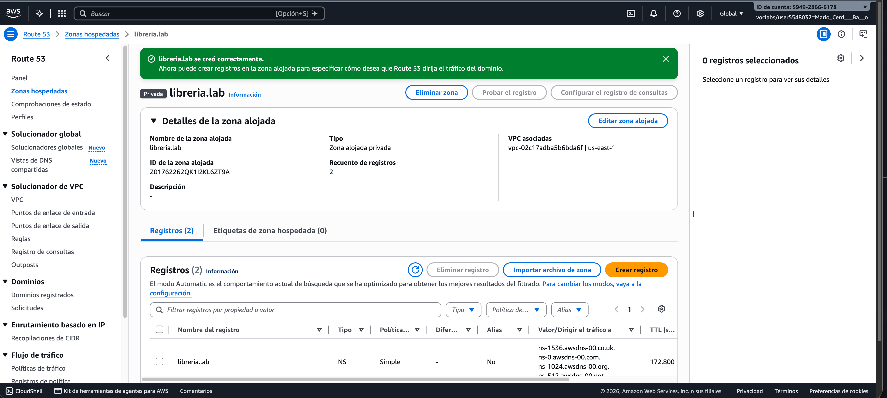
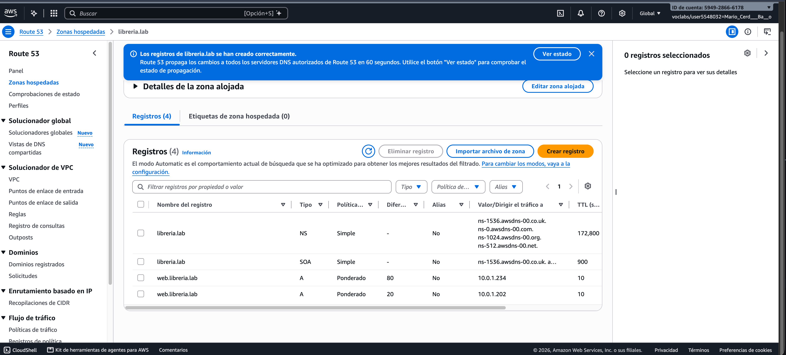

### Comprobación

Como la zona es privada, `web.libreria.lab` solo se resuelve dentro de la VPC, así que he hecho las pruebas por SSH desde el servidor 1.

Con `dig` se ve que el nombre resuelve a una de las dos IPs privadas, y que responde el DNS de la VPC (`10.0.0.2`):

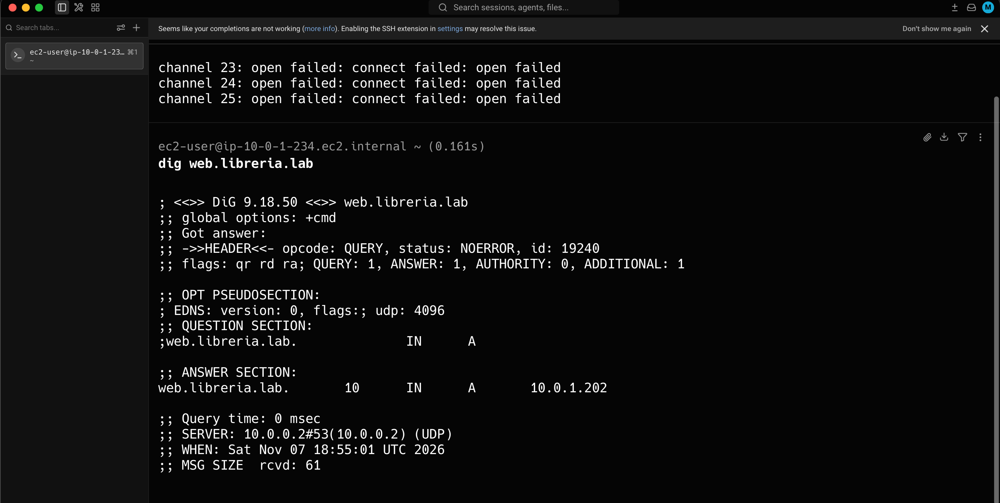

Con un bucle de `curl` he hecho 15 peticiones, esperando 11 segundos entre una y otra para que no se use la respuesta cacheada. Han respondido 13 veces el servidor 1 y 2 veces el servidor 2, que encaja con un reparto 80/20 (es por probabilidad, no exacto):

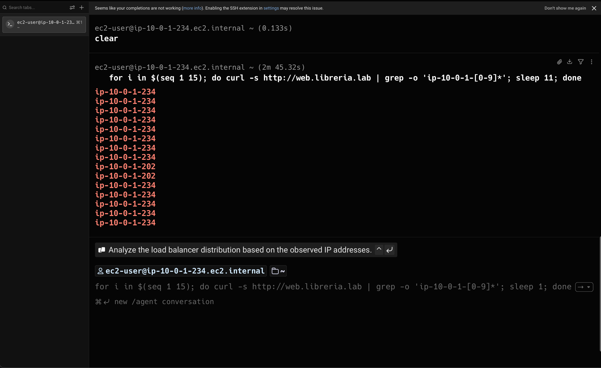

### M2. Coste actualizado

Estimación con los 2 servidores encendidos 24/7 y la zona de Route 53:

- **EC2 (2 × t3.micro):** 16,46 USD/mes
- **Route 53:** 1,20 USD/mes
- **Total:** 17,66 USD/mes (211,92 USD/año)
- **Enlace:** [Ver estimación](https://calculator.aws/#/estimate?id=bcda615637113c53a1f317239473151cc428b8f1)

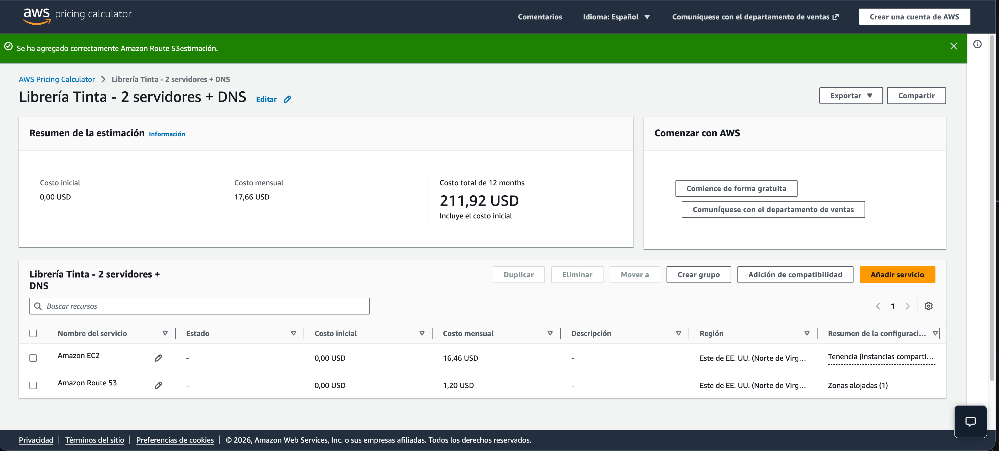

## Nivel avanzado: despliegue con la AWS CLI

He automatizado los pasos B2 y B3 con el script [`desplegar.sh`](scripts/desplegar.sh), reutilizando la red de B1. El script:

1. Busca la AMI más reciente de Amazon Linux 2023.
2. Crea el grupo de seguridad `libreria-web-cli-sg` y le abre HTTP (80) a todos y SSH (22) solo a mi IP.
3. Lanza una instancia `t3.micro` en `libreria-publica` con el `user-data1.sh` y las etiquetas del proyecto.
4. Espera a que la instancia esté en ejecución, saca su IP pública y muestra la URL.

Lo he ejecutado desde CloudShell, subiendo antes `desplegar.sh` y `user-data1.sh`:

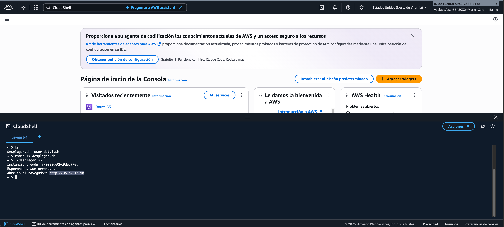

**La web desplegada por el script:**

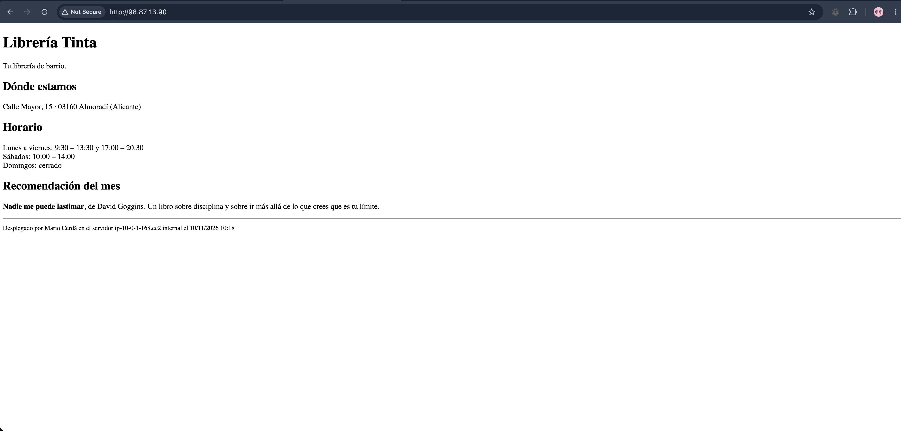

## Uso de IA

He usado **Claude** como apoyo durante el proyecto, sobre todo para resolver dudas puntuales y entender errores.

### Prompts que me resultaron útiles

- *"Me conecto por SSH a mi instancia EC2 y se queda colgado sin dar error. El grupo de seguridad tiene el puerto 22 abierto a mi IP. ¿Qué puede estar pasando?"* → Resultó que la IP pública de la instancia había cambiado al pararla y arrancarla, y yo seguía usando la antigua.
- *"¿Cómo compruebo desde dentro de la VPC que el DNS ponderado 80/20 de Route 53 reparte entre los dos servidores?"*

### Errores de la IA que detecté

**1. Las tildes de la web salían rotas.** El primer `user-data1.sh` que me dio tenía las tildes escritas tal cual, y la web mostraba "LibrerÃa" en vez de "Librería". Me dijo que era cosa de nginx y que había que configurarle el charset, pero al ver el código fuente de la página comprobé que `<meta charset="utf-8">` estaba bien y que el texto ya estaba mal dentro del archivo. Lo solucioné escribiendo las tildes como entidades HTML (`&iacute;`, `&oacute;`…).

**2. El bucle para comprobar el 80/20 no funcionaba.** Me propuso un bucle de `curl` que borraba la caché DNS local, pero las 20 peticiones salían siempre del servidor 1. En la salida de `dig` vi que quien responde es el DNS de la VPC (`10.0.0.2`), que guarda la respuesta durante el TTL de 10 segundos. Lo corregí añadiendo un `sleep 11` entre peticiones, y entonces sí respondieron los dos servidores.

### Lo que no hice

No he pegado nunca mis credenciales del Learner Lab en la IA ni las he subido al repositorio.

