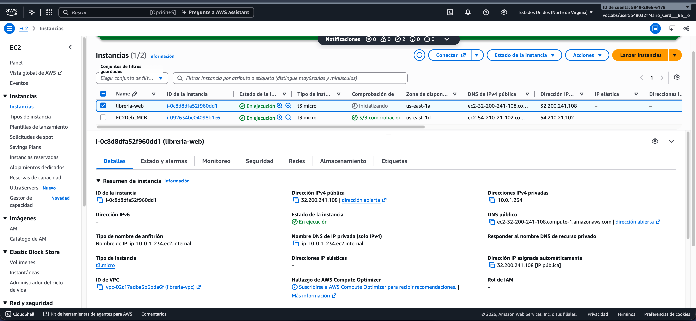
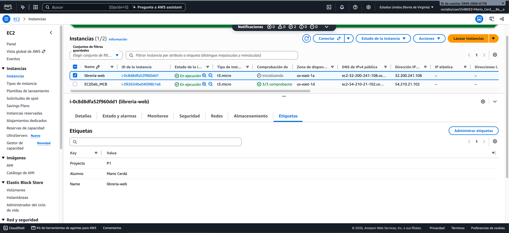
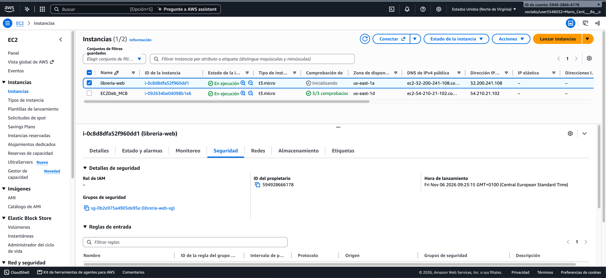
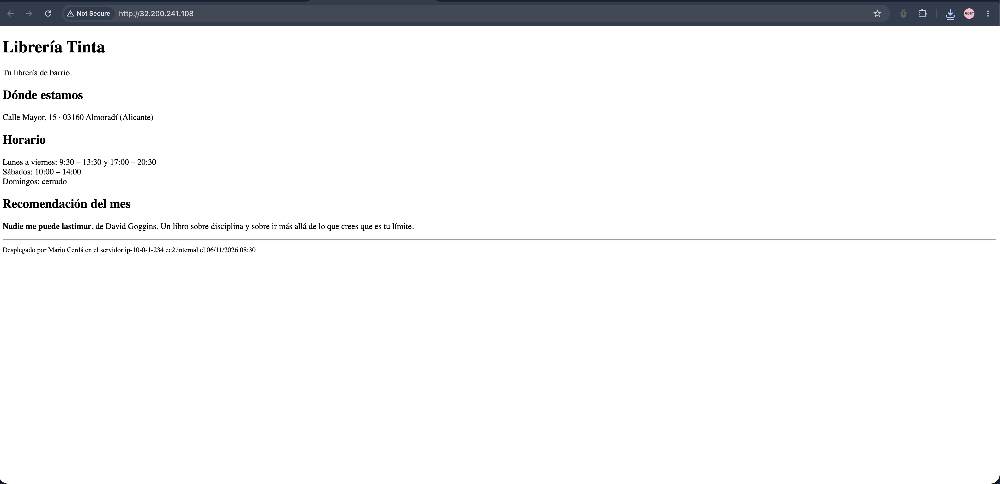
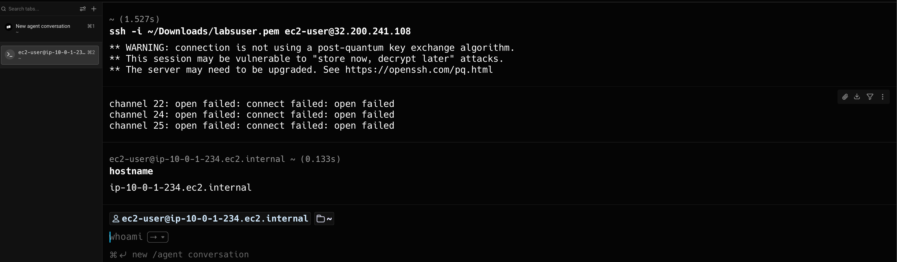
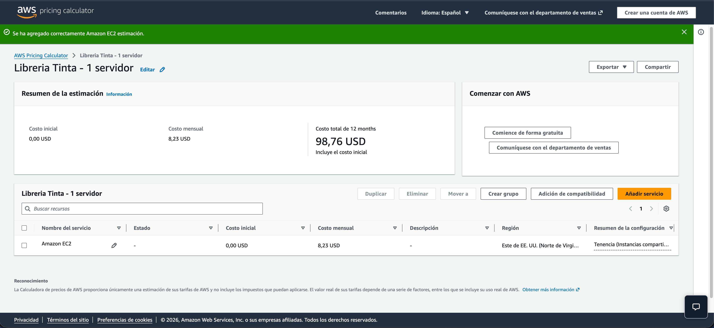

# Proyecto 1 · Mi web en AWS — Librería Tinta
Mario Cerdá Baño · 2º DAW · AWS Learner Lab (us-east-1)

## B1. La red

He creado la red a mano desde la consola de VPC, recurso por recurso:

- **VPC** `libreria-vpc` → `10.0.0.0/16`
- **Subred** `libreria-publica` → `10.0.1.0/24` en `us-east-1a`, con IP pública automática
- **Gateway de internet** `libreria-igw` → asociada a la VPC
- **Tabla de rutas** `libreria-rt-publica` → `0.0.0.0/0` hacia el gateway, asociada a la subred

**¿Por qué la subred es pública?** Porque su tabla de rutas manda el tráfico de internet (`0.0.0.0/0`) al gateway, y las instancias reciben IP pública al lanzarse.

## B2. La seguridad

Grupo `libreria-web-sg` con dos reglas de entrada:

- **HTTP (80)** abierto a todos, para que cualquiera vea la web.
- **SSH (22)** solo desde mi IP.

**¿Por qué el SSH solo a mi IP?** Porque es la puerta para administrar el servidor. Si la dejo abierta a todo internet, cualquiera podría intentar entrar.

## B3. El servidor web

Instancia EC2 `libreria-web` con Amazon Linux 2023, tipo `t3.micro`, clave `vockey`, en la subred `libreria-publica` y con el grupo `libreria-web-sg`. Lleva las etiquetas `Proyecto = P1` y `Alumno = Mario Cerdá`.

Al arrancar ejecuta el script [`user-data1.sh`](scripts/user-data1.sh), que instala nginx y publica la página de la librería.

**La web funcionando:**

**Conexión por SSH:**

## B4. Cálculo de costes

Estimación con la AWS Pricing Calculator de la instancia `t3.micro` encendida 24/7 en `us-east-1`, bajo demanda y con 8 GB de disco gp3:

- **Coste mensual:** 8,23 USD
- **Coste anual:** 98,76 USD
- **Enlace:** [Ver estimación](https://calculator.aws/#/estimate?id=b66f60d875f58630c9f2126da7431ca4779ca971)

**¿Cómo se podría abaratar?** Apagando el servidor fuera del horario de la tienda, ya que solo se pagarían las horas que está encendido. Otra opción sería un Savings Plan a 3 años, que tiene hasta un 72 % de descuento a cambio de comprometerse a usarlo ese tiempo.
