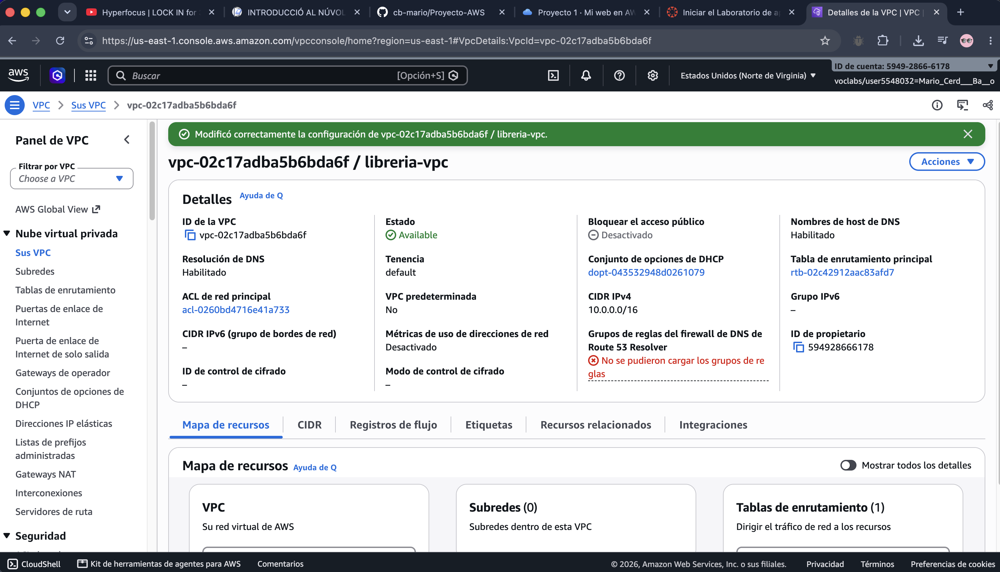
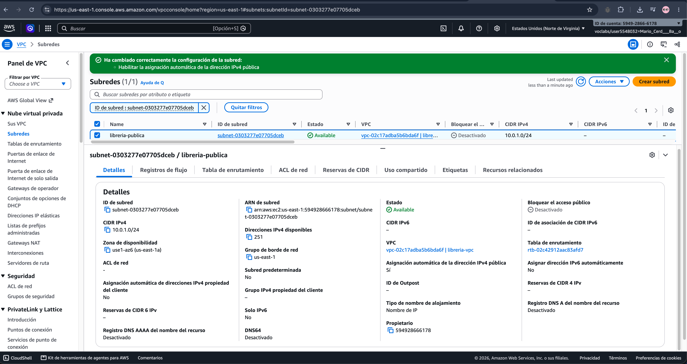
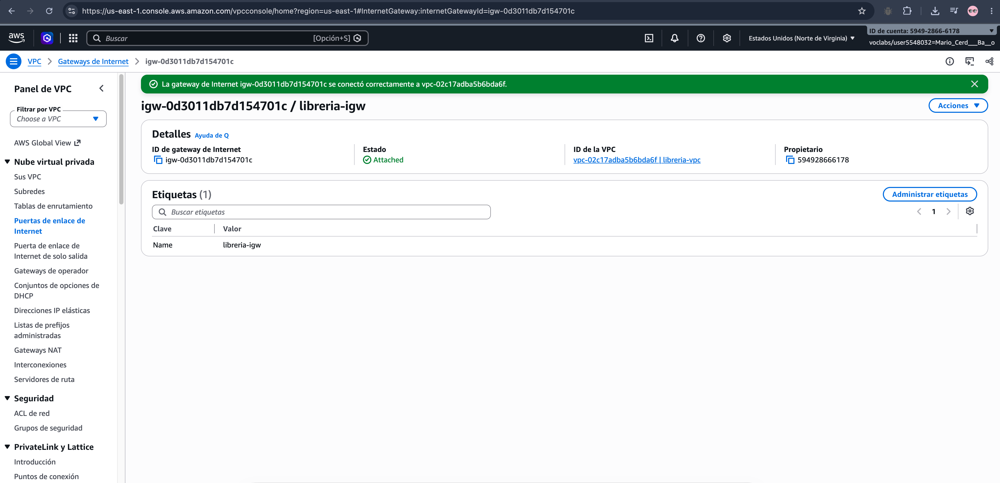
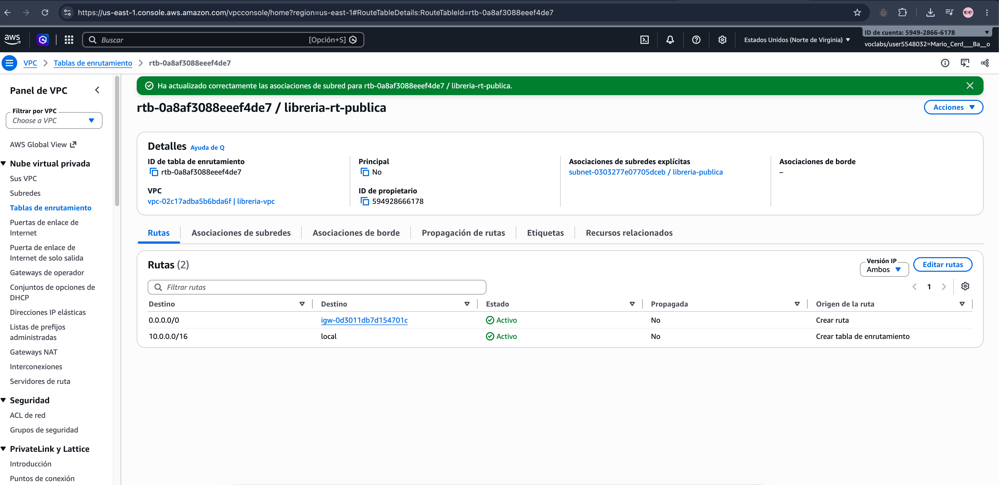
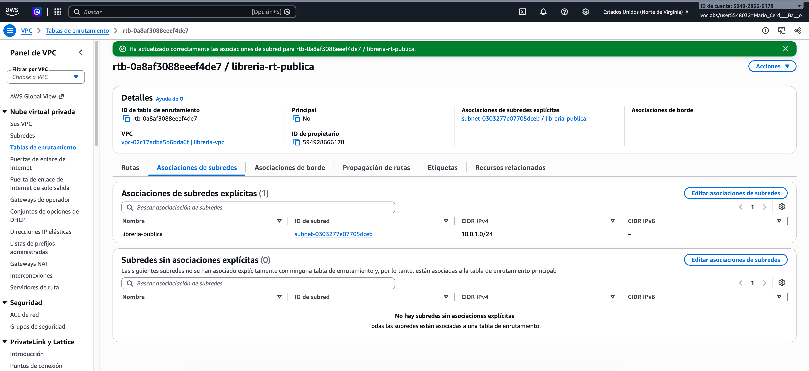
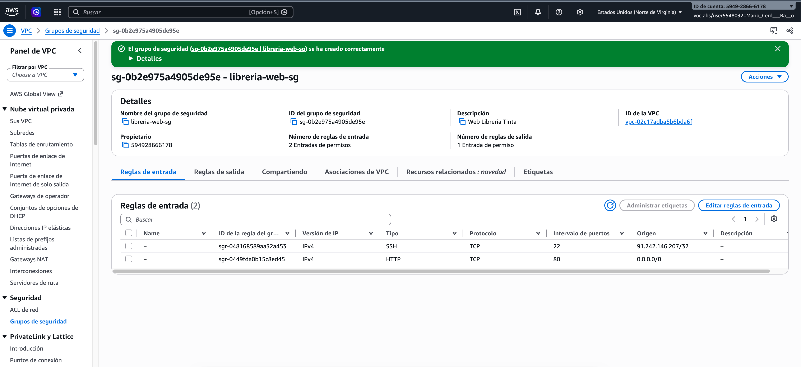

# Proyecto-AWS
Mario Cerdá Baño · 2º DAW · AWS Learner Lab (us-east-1)

## B1. La red

He creado la red a mano desde la consola de VPC, recurso por recurso:

- **VPC** `libreria-vpc` → `10.0.0.0/16`
- **Subred** `libreria-publica` → `10.0.1.0/24` en `us-east-1a`, con IP pública automática
- **Gateway de internet** `libreria-igw` → asociada a la VPC
- **Tabla de rutas** `libreria-rt-publica` → `0.0.0.0/0` hacia el gateway, asociada a la subred

**¿Por qué la subred es pública?** Porque su tabla de rutas manda el tráfico de internet (`0.0.0.0/0`) al gateway, y las instancias reciben IP pública al lanzarse.

## B2. La seguridad

Grupo `libreria-web-sg` con dos reglas de entrada:

- **HTTP (80)** abierto a todos, para que cualquiera vea la web.
- **SSH (22)** solo desde mi IP.

**¿Por qué el SSH solo a mi IP?** Porque es la puerta para administrar el servidor. Si la dejo abierta a todo internet, cualquiera podría intentar entrar.
